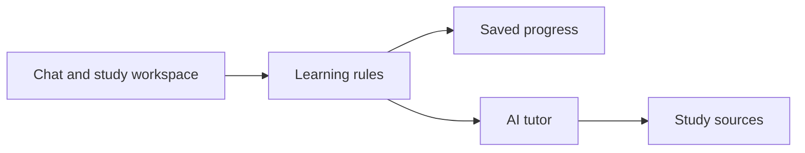

**First Slice**

**Goal**

Start with a simple home page, then prove the learning loop for SAT linear equations. This is a starting point for the larger platform, not a plan for every future feature.

**Experience**

- A home page introduces the product and offers **Get Started**.
- Guided setup asks for a learning goal; uploading material is optional.
- A named chat suggests activity cards that open a session overview.
- The learner answers a diagnostic question. A follow up question gathers evidence before a misconception is treated as more than a possibility.
- A targeted lesson is followed by different practice questions. Three independent correct answers without hints signal improvement; the skill returns for review later.
- Progress persists across sessions. Initial testing is personal, with invited and public learners as later goals.

**Boundaries**

Use math templates for reliable question generation. Support selectable PDFs, Word documents, and plain text as study sources. Keep specialist agents, scanned documents, and the wider subject catalog for later. The home page can use the desired black and orange direction without delaying the learning loop.

**Technical Direction**

**Starting point**

The project currently contains IDE metadata but no application source. Start with one modular Next.js application. The AI provider and persistent database remain choices to settle as the first slice is developed; compare current model costs and limits rather than assume free access.

**Responsibilities**

Application code generates and grades supported math questions, stores attempts and possible misconceptions, and controls improvement and review state. AI helps with conversation and targeted explanations; its output does not directly mark mastery. Chat cards open predefined application components rather than model generated code.

When a document is present, extract readable passages for the tutor and identify their source where possible. If material is absent or unreadable, say so rather than inventing a citation. Exact review intervals and provider selection can be decided later.

**Proposed files**

- `src/app/`: home page, guided setup, chat, and study session routes.
- `src/lib/learning/`: question templates, grading, evidence, and review rules.
- `src/lib/ai/`: model integration and validated responses.
- `src/lib/documents/`: study material extraction and source handling.
- Persistence and tests: locations chosen with the database and project scaffold.

**Interactions**

**Validation**

**Checks**

- A learner can move from the home page through setup into a named chat and open an activity.
- A wrong answer creates evidence, and a follow up question does not automatically prove a misconception.
- Template answers are graded consistently; three different correct answers without hints signal improvement and a later review is recorded.
- Sessions work without an upload. Readable supported documents can inform explanations; unreadable sources produce a clear message.
- AI failures or unverifiable responses do not silently change progress.

**Delivery Steps**

**Step 1: Create the welcome and setup flow**

A learner can enter a basic study workspace from the home page.

- Scaffold the Next.js application in `src/app/`.
- Add a simple black and orange welcome page with **Get Started**.
- Add guided setup for a learning goal, keeping study material optional.
- Check the entry flow and responsive rendering.

**Step 2: Connect chat and study activities**

A named chat can offer a card that opens a session overview.

- Add the chat and study session routes under `src/app/`.
- Add a replaceable AI integration in `src/lib/ai/` with usage and failure handling.
- Render suggested activities with predefined components and retain chat history.
- Check navigation between chat and the session overview.

**Step 3: Build the SAT learning loop**

A learner can practice linear equations and receive evidence based follow up and review.

- Add deterministic question templates and grading in `src/lib/learning/`.
- Persist attempts and possible misconceptions; use a different follow up question to gather evidence.
- Provide targeted AI explanations and practice, requiring three independent correct answers without hints for improvement.
- Record a later review using application controlled rules; verify progress and failure cases.

**Step 4: Add optional study sources**

A learner can use supported documents to inform a study session.

- Extract readable text from selectable PDFs, Word documents, and plain text in `src/lib/documents/`.
- Supply relevant passages to the tutor and show source information when available.
- Handle missing, unsupported, or unreadable material without fabricating citations.
- Verify that the learning loop also works without an upload.